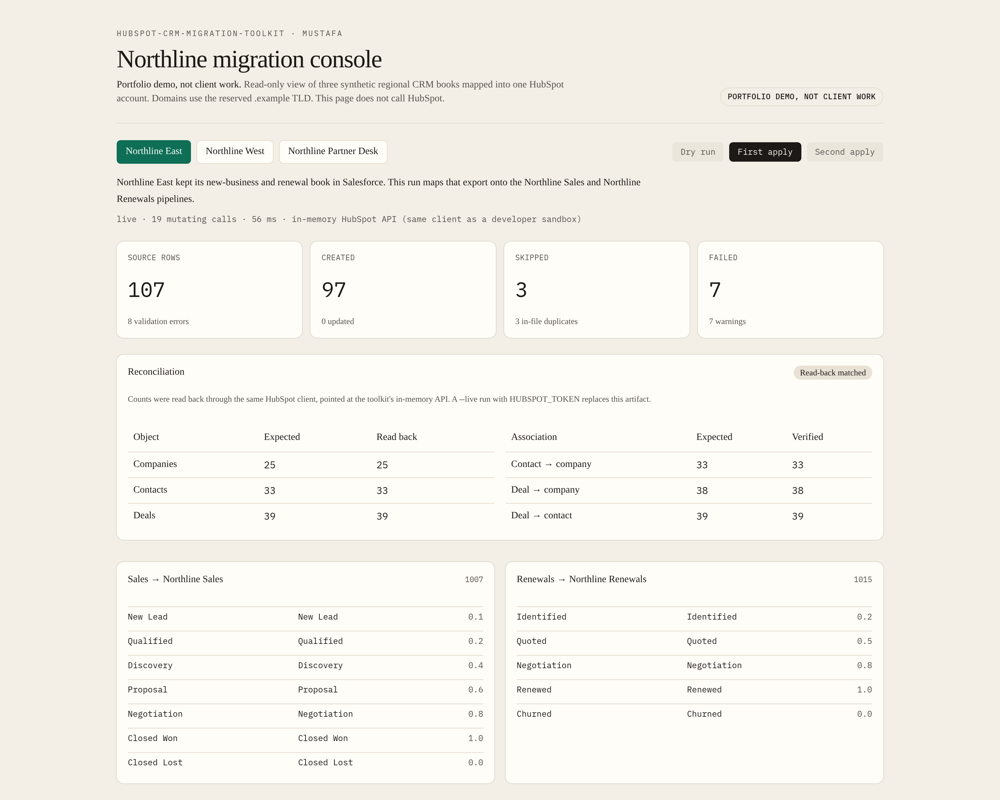
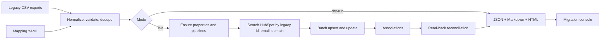

# hubspot-crm-migration-toolkit

[](https://github.com/mustafaautomation/hubspot-crm-migration-toolkit/actions/workflows/ci.yml)

**Portfolio demo, not client work.**

Live demo: https://crm.quvantic.com



A TypeScript CLI and library that migrates legacy CRM CSV exports into a HubSpot developer sandbox. The sample books belong to Northline, a fictional revenue-intelligence vendor consolidating three regional systems:

| Book | Export style | HubSpot pipelines |
| --- | --- | --- |
| Northline East | Salesforce report export | Northline Sales, Northline Renewals |
| Northline West | Pipedrive list export (numeric stage ids) | Northline Sales, Northline Partnerships |
| Northline Partner Desk | Zoho CRM export | Northline Sales (adds Value Proposition), Northline Customer Success |

Every company domain is on the reserved `.example` TLD. Phone numbers use the fictional `555-01xx` range. There is no real personal data in this repository.

Author: [Mustafa](https://github.com/mustafaautomation).

## What it does

For each source file the toolkit:

1. Applies a declarative YAML mapping: column to HubSpot property, transforms, picklists, and required fields.
2. Maps source deal stages onto a HubSpot pipeline id and stage id. A stage or pipeline that is not in the config fails that row.
3. Validates the row and writes a per-row error report (bad emails, missing required fields, invalid enums, unmapped stages, unparseable dates).
4. Dedupes inside the file and against HubSpot: contacts by email, companies by domain, deals by the `legacy_external_id` custom property.
5. In `--dry-run`, performs no writes and prints what would be created, updated, skipped, or failed. With a token it still reads HubSpot so the create/update split is exact.
6. In `--live`, ensures custom properties (including unique `legacy_external_id`) and deal pipelines, then batch-upserts. Running the same file again updates those records and does not create duplicates.
7. Associates contact to company, deal to company, and deal to contact from the source ids, including when a duplicate row was collapsed onto the record that was kept.
8. Retries HTTP 429 responses using `Retry-After` when present, otherwise exponential backoff with jitter. Batches stay within HubSpot's 100-record limit.
9. Reads the written records and associations back and checks them against the run. The report is JSON, Markdown, and HTML.
10. Can resume a live run from a checkpoint if a batch fails partway through.

## Architecture



`src/` is the library and CLI. Tests talk to `startMockHubSpot()`, an in-memory HTTP server that implements the CRM endpoints the client uses, so CI never needs a HubSpot account. `--live` points the same client at `https://api.hubapi.com` when `HUBSPOT_TOKEN` is set.

## Quickstart

```bash
npm install
npm test
npm run migrate -- run \
  --config mappings/salesforce.yaml \
  --input samples/salesforce \
  --dry-run \
  --out artifacts/northline-salesforce-dry-run
```

Dry-run is the default when `--live` is omitted. It exits 0 even when the sample file contains deliberate bad rows; those rows are the validation report.

### Dry-run output

This is the Salesforce sample with no token, so HubSpot is not queried and every valid new record is a create:

```text
hubspot-crm-migration-toolkit
Portfolio demo, not client work. Records are synthetic. Domains use the reserved .example TLD. No real personal data.

Northline East (salesforce) · dry-run · would write 0
target not queried

object     source  valid  invalid  dupes  created  updated  skipped  failed
companies  28      26     2        1      25       0        1        2
contacts   37      34     3        1      33       0        1        3
deals      42      40     2        1      39       0        1        2

associations
  contact → company    planned 33  create 33  skip 0  fail 0
  deal → company       planned 39  create 38  skip 1  fail 0
  deal → contact       planned 39  create 39  skip 0  fail 0

validation errors: 8
  companies row 27 001NS000000ABAD: industry — invalid value "Astrology"
  companies row 28 001NS000000ANON: name — required value is missing
  contacts row 34 003NS000000CBAD: email — invalid email "not-an-email"
  contacts row 35 003NS000000CNOL: lastname — required value is missing
  contacts row 37 003NS000000CEMP: firstname — required value is missing
  contacts row 37 003NS000000CEMP: email — required value is missing
  deals row 39 006NS000000OBAD: dealstage — unmapped stage "Verbal Yes" for pipeline "Sales"
  deals row 41 006NS000000ODAT: closedate — invalid date "yesterday"
```

The full Markdown and HTML for a recorded run are in `artifacts/northline-salesforce-dry-run.md` and `artifacts/northline-salesforce-applied.md`.

## Configuration

Mappings live in `mappings/`. A deal stage is not a free-text property. The pipeline block is the allow-list, and every value in the file has to match one entry (case-insensitive).

```yaml
pipelines:
  - sourceName: Sales
    hubspotLabel: Northline Sales
    stages:
      - { source: Closed Won, label: Closed Won, probability: "1.0", closedWon: true }
      - { source: Closed Lost, label: Closed Lost, probability: "0.0", closedLost: true }
  - sourceName: Renewals
    hubspotLabel: Northline Renewals
    stages:
      - { source: Renewed, label: Renewed, probability: "1.0", closedWon: true }

objects:
  contacts:
    file: contacts.csv
    idColumn: Contact ID
    dedupeProperty: email
    associations:
      - { column: Account ID, to: companies }
    fields:
      - { column: Email, property: email, required: true, transforms: [email] }
  deals:
    file: opportunities.csv
    idColumn: Opportunity ID
    dealPipelineColumn: Pipeline
    dealStageColumn: Stage
```

Pipedrive uses the same shape with numeric stage ids (`source: "6"` becomes HubSpot stage Closed Won on pipeline Northline Sales). Transforms include `trim`, `lowercase`, `email`, `phone`, `domain`, `date`, `number`, `split_first`, and `split_last`. Picklists use `valueMap`. On a live run, `Closed Won` is sent as the pipeline's stage id, not the label.

Custom properties declared in the file are created if they are missing. `legacy_external_id` is unique and is the upsert key for all three objects. Companies and contacts are also matched to existing HubSpot records by domain and email so a sandbox that already has the company is updated instead of duplicated. A match whose unique id already belongs to a different legacy record is skipped as a conflict.

## Live sandbox

Create a private app on a HubSpot developer test account. Free CRM objects only: no paid seats and no custom objects. Scopes:

- `crm.objects.contacts.read`, `crm.objects.contacts.write`
- `crm.objects.companies.read`, `crm.objects.companies.write`
- `crm.objects.deals.read`, `crm.objects.deals.write`
- `crm.schemas.contacts.read`, `crm.schemas.contacts.write`
- `crm.schemas.companies.read`, `crm.schemas.companies.write`
- `crm.schemas.deals.read`, `crm.schemas.deals.write`
- `crm.objects.owners.read`

```bash
export HUBSPOT_TOKEN=pat-...   # never commit this
npm run migrate -- run \
  --config mappings/salesforce.yaml \
  --input samples/salesforce \
  --live \
  --checkpoint artifacts/salesforce.checkpoint.json \
  --out artifacts/northline-salesforce-live
```

Copy `artifacts/northline-salesforce-live.json` to `web/data/reports/` and refresh the dashboard. The console labels any artifact whose target is `api.hubapi.com` as a sandbox read-back.

`npm test` skips `tests/live.test.ts` unless `HUBSPOT_TOKEN` is set. That test writes a handful of stable `toolkit-itest-*` records and a pipeline named `Toolkit ITest Sales`, then runs again and asserts the second pass creates nothing.

Exit code 2 means a live reconciliation did not match. Exit code 1 is a usage or API failure.

## Sample reconciliation

Recorded by `npm run demo:record` against the in-memory HubSpot API (the same client code `--live` uses). First Salesforce apply:

| Object | Expected | Read back |
| --- | ---: | ---: |
| companies | 25 | 25 |
| contacts | 33 | 33 |
| deals | 39 | 39 |

| Association | Expected | Verified |
| --- | ---: | ---: |
| contact → company | 33 | 33 |
| deal → company | 38 | 38 |
| deal → contact | 39 | 39 |

The second apply of the same file creates 0 companies, 0 contacts, and 0 deals (25 / 33 / 39 updates). The read-back still matches. Pipedrive and Zoho bundles in `artifacts/bundles/` behave the same way, and a shared run reuses Northline Sales instead of creating a second copy of that pipeline.

## Dashboard

A read-only Next.js console shows the mapping, validation errors, dry-run diff, and reconciliation for each recorded book. The deployed page is built from the committed bundles in `web/data/bundles` (Salesforce, Pipedrive, and Zoho). It does not call HubSpot and does not read `HUBSPOT_TOKEN`.

```bash
npm run dashboard
```

Open [the migration console](http://127.0.0.1:43123). JSON dropped in `web/data/reports/` is shown only when you run the app locally. Those files are gitignored, so they are not part of the Vercel deployment.

### Vercel

Create one project from this GitHub repository. `web/vercel.json` sets the framework, install command, and build command. In the project settings, use:

| Setting | Value |
| --- | --- |
| Framework preset | Next.js |
| Root Directory | `web` |
| Install Command | `npm ci` |
| Build Command | `npm run build` (`next build --turbopack`) |
| Output Directory | Default. Leave the override off. Next.js publishes `.next`. |

No environment variables. The Hobby (free) tier is enough. After the first successful deployment, attach `crm.quvantic.com`.

## Tests

```bash
npm run lint
npm run typecheck
npm test
npm run build
```

The suite covers transforms, stage mapping, validation, in-file and HubSpot dedupe, idempotent re-runs, associations (including orphans and collapsed duplicates), 429 retry, dry-run write counts, checkpoint resume, reconciliation totals, and the CLI. GitHub Actions runs lint, types, tests, the library build, and the dashboard build.

Regenerate the synthetic CSVs with `npm run generate:samples` and the dashboard artifacts with `npm run demo:record`.

## Demo video

Placeholder. Record a short walkthrough once a developer-sandbox token is available:

1. Dry-run `samples/salesforce` and scroll the validation report.
2. `migrate run --live`, including the created Sales and Renewals pipelines.
3. A contact associated to its company, and a deal on the mapped stage, in the HubSpot UI.
4. The dashboard showing that live reconciliation artifact.

Put the link here.

## Stack

TypeScript on Node 22. The CLI uses Commander. Mappings are checked with Zod. CSV parsing is `csv-parse`. Tests are Vitest. The console is Next.js, Tailwind, and shadcn/ui. No paid HubSpot products are required.

## License

MIT. Copyright 2026 Mustafa.
